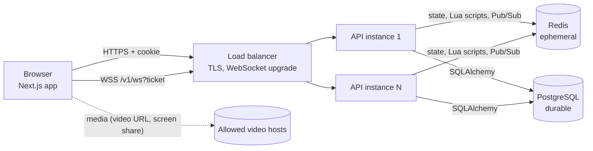

# Architecture

Prism's backend is one FastAPI service that can run as many identical instances. Every instance serves REST and WebSockets and runs the same background loops. All shared live state is in Redis. Durable records are in PostgreSQL.

The API never relays or stores media bytes. Watch Together shares a URL and a playback clock, and each browser loads the video itself.

## Modules

| Path | Responsibility |
|---|---|
| `app/main.py` | App factory, lifespan (startup checks, workers, graceful shutdown), middleware order |
| `app/config.py` | Typed settings (`PRISM_*`). `validate_for_env()` refuses insecure production configs |
| `app/api/` | Thin route handlers: parse, authorize, call a service, return a schema |
| `app/schemas/` | Pydantic request/response models mirroring `frontend/src/lib/api/types.ts` (camelCase JSON) |
| `app/services/` | Business logic: sessions, catalog/flags, solo, rooms, live games, matchmaking, moderation, admin, timers, events, rate limits |
| `app/games/` | Game engine contract, built-in games, content and grading. No I/O |
| `app/redis/` | Key schema, Lua scripts, versioned-document store (CAS) |
| `app/db/` | SQLAlchemy models and engine. Migrations live in `migrations/` |
| `app/ws/` | WebSocket protocol models, endpoint (validation, acks, idempotency), per-process hub (fanout) |
| `app/observability.py`, `app/middleware.py`, `app/errors.py` | JSON logs with request ids and redaction, Prometheus metrics, error-tracking hook, CSRF, body limits, uniform error shape |

Route handlers contain no rules. For example, "only the host can start" lives in `RoomService.start`, and "answers are graded server-side" lives in `GameDefinition.grade`.

## Storage decision

| Data | Store | Why |
|---|---|---|
| Guest profile and consent timestamp, roles, suspension | PostgreSQL `users` | Must survive a Redis flush. It is the identity behind reports and blocks |
| Blocks | PostgreSQL `blocks` | Blocked users must stay apart across sessions and restarts |
| Reports, resolutions | PostgreSQL `reports` | Needed for incident review. Retention job redacts, then deletes |
| Audit trail | PostgreSQL `audit_events` | Append-only record of privileged actions |
| Feature flags, catalog overrides | PostgreSQL | Operator decisions |
| Sessions (hashed), WS tickets, rooms, chat (last 200), live games, watch state, solo sessions, queues, presence, rate limits, idempotency keys, timers | Redis, with TTLs | Ephemeral live state. Losing it ends games and rooms but loses no records |

Losing Redis means: everyone is signed out (sessions are Redis-only), active rooms, games and queues are gone, and **profiles, blocks, reports and audit survive**. The API answers `503 unavailable` while Redis is down. It never reports false success.

## Concurrency model

- **Rooms and solo sessions** are each one versioned JSON document (`HASH {v, d}`). Every change is read → pure mutation in Python → compare-and-set Lua script, retried on conflict. Capacity, host changes, ready states and scoring therefore can't race across instances. Events are published only after the write succeeds.
- **Matchmaking** claims a group with one Lua script (all tickets or none) and creates the room idempotently from an operation id. See [MATCHMAKING.md](MATCHMAKING.md).
- **Timers** (round deadlines) are a Redis sorted set. Workers claim due jobs atomically with a lease. Handlers are idempotent (guarded by run id, round and phase).
- **Fanout** uses Redis Pub/Sub with a per-room `seq` assigned in the same Lua script that publishes. Clients resync from snapshots on gaps. See [REALTIME.md](REALTIME.md).

## Scaling

- API instances are stateless apart from their open sockets. Scale horizontally.
- **Sticky sessions are not required.** Any instance can serve any request, and a reconnecting socket can land anywhere. It re-subscribes and gets a snapshot.
- The load balancer must support WebSocket upgrades and idle timeouts above 60 s. Uvicorn sends protocol pings every 20 s.
- Redis: use a managed primary with a replica and automatic failover (e.g. Sentinel or a managed service). During failover, commands fail fast (2 s timeout) and the API returns 503s. No match is reported until its room exists.
- Redis Cluster: multi-key scripts use hash tags (`{room:<id>}`, `{seg:<segment>}`, `{timers}`), so each script touches one slot. Pub/Sub uses `PSUBSCRIBE prism:v1:ev:*`. In Cluster mode, classic Pub/Sub is broadcast to all nodes, which is correct but costs bandwidth. At scale, move to sharded Pub/Sub (`SSUBSCRIBE` per room). `{timers}` is a single hot slot. Shard it into N buckets when timer volume demands it.
- Each instance receives every event and filters locally, which is simple and correct. At high event volume, subscribe per room instead.
- WebRTC audio/video (not implemented) would need an SFU (e.g. LiveKit or mediasoup) with the API only issuing join tokens. Media must never flow through FastAPI or Redis.
