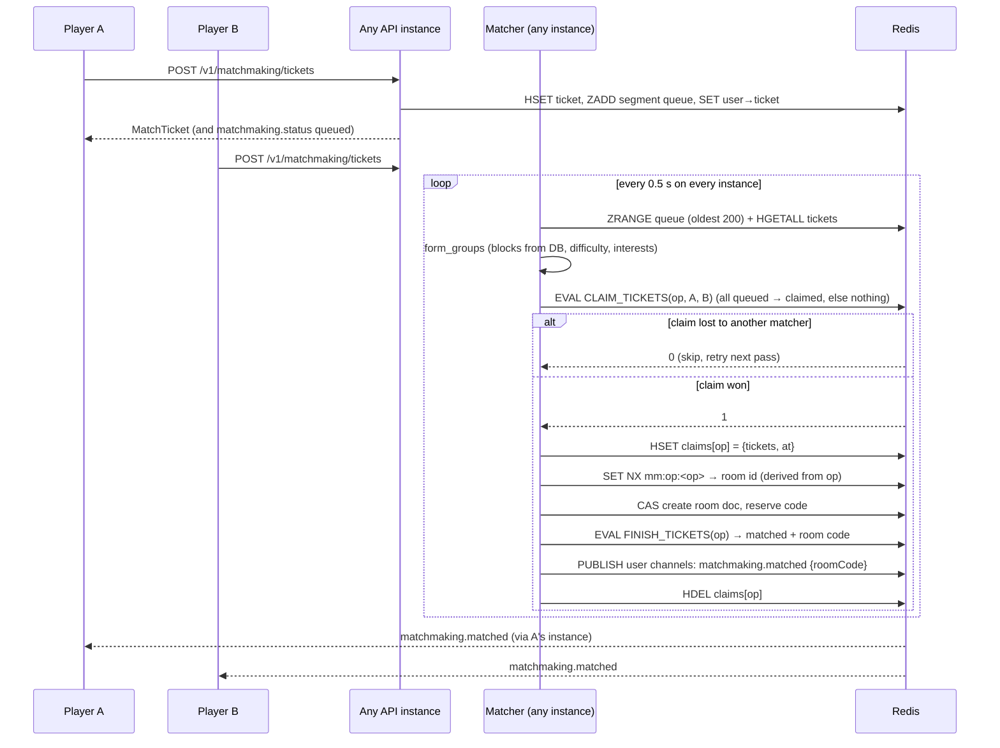

# Matchmaking

## Rules

- **Segments:** `game × language × group size × age group`. Minors (13–17) only match minors. This is a safety rule, not a ranking signal.
- **Ranking:** queue time first (oldest ticket anchors the group). Among tickets that have waited about the same time (10 s window), shared interests rank higher, but only for people who opted in to interest-based matching. Protected traits are never stored or used.
- **Difficulty** must match the anchor's until both tickets have waited `match_widen_after_sec` (30 s, phase `widening`). After that, mixed difficulties may match and the room uses the anchor's difficulty.
- **Blocks:** a pair where either player blocked the other is never grouped (blocks come from PostgreSQL, so they survive Redis loss).
- **One ticket per user:** enqueueing again cancels the previous ticket. Tickets expire after `match_ticket_ttl_sec` (120 s, phase `expired`).
- Phases sent to the player: `queued → searching → widening? → matched | expired | cancelled`. No wait-time promises.

## Sequence

## What if a worker dies during a match?

Players are told "matched" only by `FINISH_TICKETS`, which runs after the room exists. A crash therefore never produces a false success. Every claim is recorded in `mm:{seg}:claims` before any side effect. Each matcher pass also runs `recover_claims()`, which looks at claims older than `match_claim_lease_sec` (15 s):

| Crash point | Recovery |
|---|---|
| after claim, before room creation | room doesn't exist → `RELEASE_TICKETS` puts tickets back **at their original queue position** (score = original enqueue time) |
| after room creation, before finishing | `mm:op:<op>` points to a room whose `matchOp` is this op → `FINISH_TICKETS` + notify. Same room, no duplicate |
| after finishing | claim entry is already gone. Nothing to do |
| Redis timeout mid-way | the exception path releases the claim. If Redis was unreachable, recovery handles it later |

Retries are safe because the room id is derived from the op id and reserved with `SET NX`, and every script only touches tickets still claimed by that op.

Tested in `tests/test_matchmaking.py`: concurrent enqueue/cancel, 10 matchers on two instances racing over the same 4 players (exactly 2 rooms), both crash points, minors segregation, blocked pairs, expiry and widening.

## Metrics

`prism_mm_queue_depth{segment}`, `prism_mm_match_wait_seconds` (histogram, per game), `prism_mm_matches_total`, `prism_mm_claim_conflicts_total`, `prism_mm_claims_released_total`, `prism_mm_expired_total`, plus hourly match counts and median wait in `GET /v1/admin/overview`.
